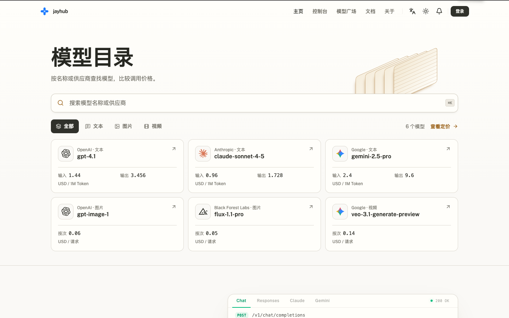
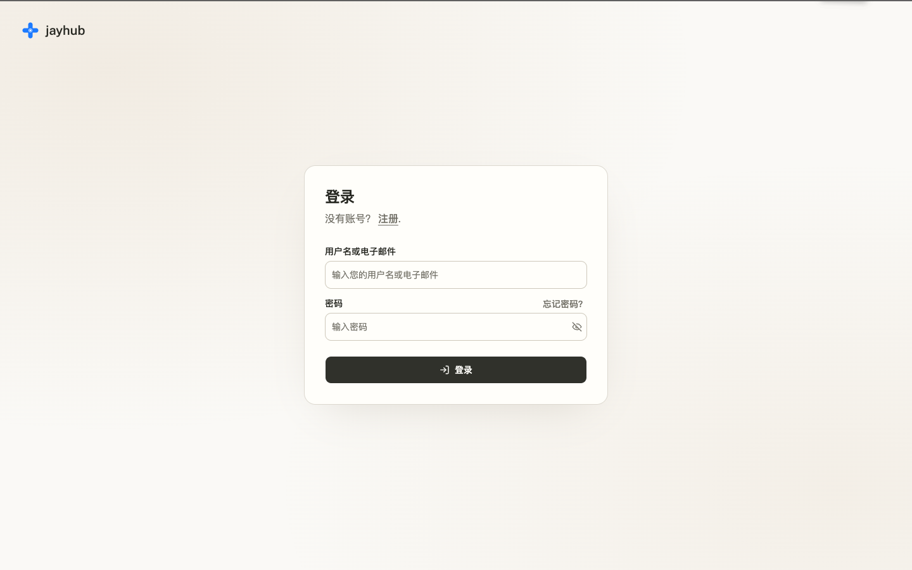

# jayhub · Operator guide

[简体中文](./README.zh_CN.md) · [繁體中文](./README.zh_TW.md) · [Français](./README.fr.md) · [日本語](./README.ja.md)

You deploy this AI gateway on your own domain and issue API keys to your users. Your site forwards requests to the supplier's gateway using the upstream API key assigned to your account. The supplier routes them to the model providers.

You set retail prices, manage user balances, and handle refunds on your site. The supplier bills you separately for usage recorded on your upstream account.

## Deployment and handover

| Task | Guide |
| --- | --- |
| Deploy the site, configure HTTPS, create the first administrator, and back up or upgrade the installation | [Single-server deployment guide (Simplified Chinese)](./delivery/DEPLOYMENT.zh-CN.md) |
| Set up the upstream channel, configure retail prices, and verify model calls against both billing records | [Customer handover manual (Simplified Chinese)](./delivery/甲方交付手册.md) |

Use the delivery Compose file for this edition. It builds the branded web and API service from this repository and starts PostgreSQL and Redis alongside it. [Delivery Compose file](./delivery/compose.yaml)

## Public pages

### Home `/`

The default home page opens with a model directory. Users can search by model or provider, filter by text, image, or video, and select a model to see its pricing. API request examples appear below the directory. The catalog follows the site's model marketplace visibility settings. If you set a custom home page, visitors see that page instead.

The screenshots show the Simplified Chinese interface. The models and prices shown below are sample data.

### Sign in `/sign-in`

The upper-left corner displays your site's name and logo. When password sign-in is enabled, users enter their username or email address and password in the centered form. Registration and other sign-in options follow your site settings. To change the displayed name or logo, open the site settings in the administrator console.

## Copyright and attribution

This edition is based on [New API](https://github.com/QuantumNous/new-api) `v1.0.0-rc.51`. Copyright (c) QuantumNous and contributors. The site footer links to the upstream project and displays its attribution.

> Frontend design and development by New API contributors.

The project is licensed under GNU AGPLv3. [LICENSE](./LICENSE) · [NOTICE](./NOTICE) · [Third-party licenses](./THIRD-PARTY-LICENSES.md)
