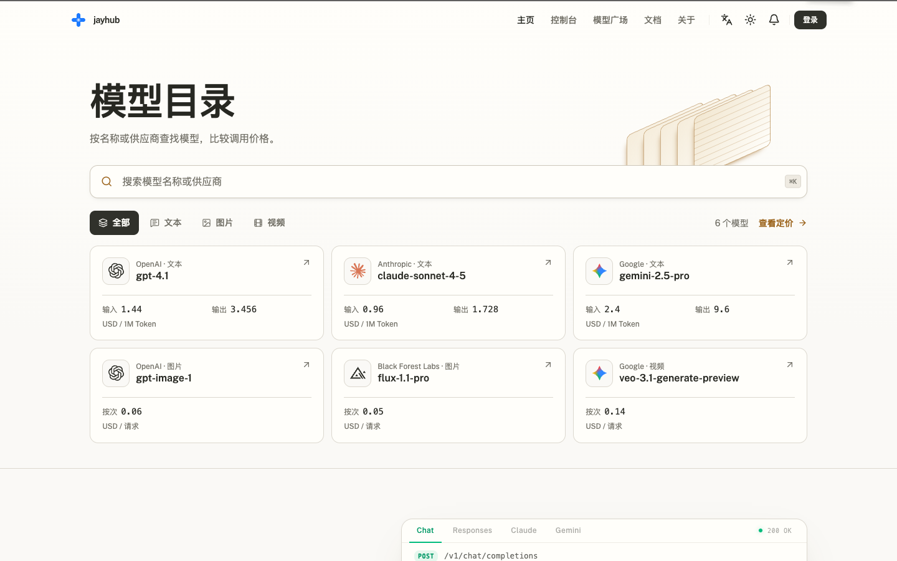
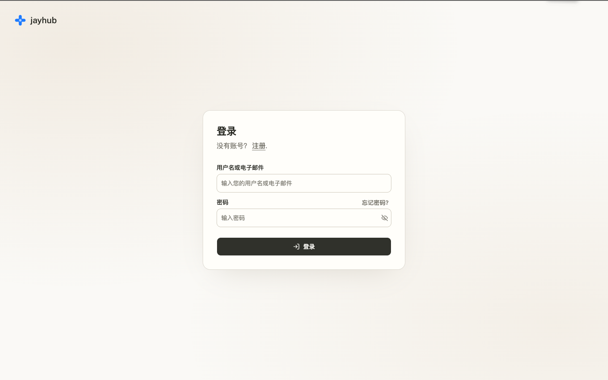

# jayhub · 甲方站点交付说明

jayhub 是由甲方独立部署和运营的 AI 模型网关。终端用户使用甲方站点签发的 API 密钥调用模型。甲方站点使用供货方分配的上游密钥，将请求转发至供货方网关，再由供货方接入官方模型渠道。

甲方管理本站的用户、对外定价、额度和退款。供货方按其平台上甲方账户的账单与甲方结算，两套账单独立。

## 接手与部署

| 我要做什么 | 从哪里开始 |
| --- | --- |
| 接收项目、配置上游渠道、设置零售价、完成业务验收 | [甲方交付手册](./delivery/甲方交付手册.md) |
| 在服务器上部署站点、初始化管理员、备份或升级 | [单机部署与运维](./delivery/DEPLOYMENT.zh-CN.md) |

首次部署请按运维文档准备 HTTPS 域名和部署密钥。交付版使用 Docker Compose 从本仓库源码构建网页和 API 服务，并启动 PostgreSQL 和 Redis。[查看交付版 Compose 文件](./delivery/compose.yaml)

## 用户看到的页面

### 首页 `/`

默认首页以模型目录开头，方便用户在接入前查看可用模型和调用价格。用户可以搜索模型名称或供应商，按文本、图片、视频筛选，点击模型卡片查看定价详情。目录下方提供 API 调用示例。目录可见范围遵循后台「模型广场」设置，要求登录时会显示登录入口。如果管理员配置了自定义首页，访客将看到该页面。

截图中的模型和价格为演示数据，实际展示以本站配置和用户权限为准。

### 登录页 `/sign-in`

页面左上角显示本站名称和 Logo，中央是单列登录表单。启用密码登录时，用户可用用户名或电子邮件和密码登录。甲方可在后台控制注册和其他登录方式，登录后进入原有控制台。要替换默认站名或 Logo，请在「系统设置 → 站点 → 系统信息」中保存甲方品牌。

## 上游版权与署名

本交付版基于 [New API](https://github.com/QuantumNous/new-api) `v1.0.0-rc.51`。上游版权声明为 **Copyright (c) QuantumNous and contributors.** 以下署名与原项目链接一同保留在站点页脚。

> Frontend design and development by New API contributors.

项目采用 GNU Affero General Public License v3.0。授权条款、附加署名要求及第三方版权信息见 [LICENSE](./LICENSE)、[NOTICE](./NOTICE) 和[第三方许可证](./THIRD-PARTY-LICENSES.md)。
